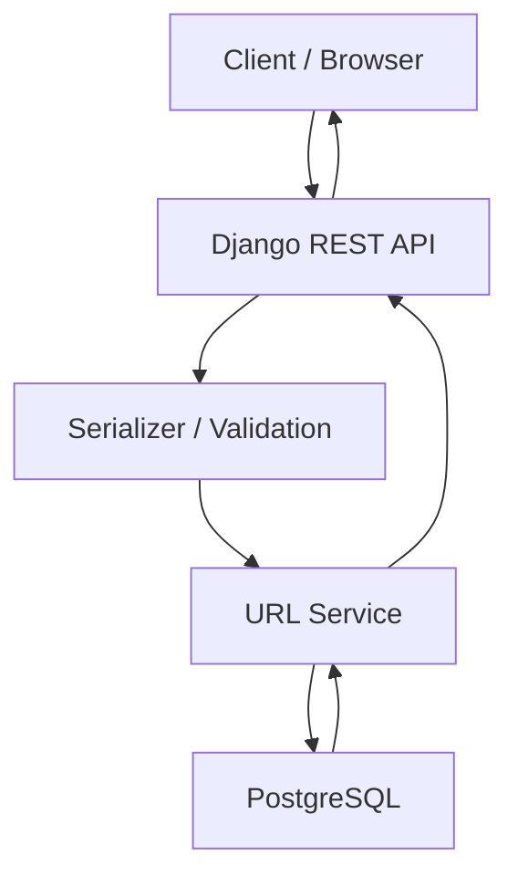

# LinkLite — System Design

## 1. Overview

LinkLite is a URL shortening platform that converts long URLs into shorter identifiers and redirects visitors to their original destinations.

## 2. Architectural Style

The application will use a modular monolithic architecture.

Django REST Framework will handle incoming API requests, while PostgreSQL will provide persistent storage.

The system will initially operate as a single deployable backend application.

## 3. Technology Stack

| Layer | Technology |
|---|---|
| Backend | Django |
| API | Django REST Framework |
| Database | PostgreSQL |
| Language | Python |
| Version Control | Git |

## 4. Main Components

### API Layer
Responsible for:
- Receiving HTTP requests.
- Validating incoming data through serializers.
- Returning appropriate HTTP responses.

### Business Logic Layer
Responsible for:
- Generating short codes.
- Checking for duplicate URLs.
- Coordinating URL creation.
- Retrieving destination URLs.

### Data Access Layer
Responsible for:
- Interacting with PostgreSQL.
- Creating URL records.
- Retrieving URL mappings.
- Enforcing database constraints.

## 5. High-Level Architecture

## 6. Request Processing

The application has two primary operations:

1. URL creation.
2. URL redirection.

Detailed request processing is documented in `03-request-lifecycle.md`.

## 7. Database

PostgreSQL will store original URLs, short codes and creation timestamps.

The database will enforce uniqueness constraints.

## 8. Reliability Considerations

- Database constraints prevent duplicate short codes.
- Database transactions protect related database operations.
- Unique code collisions will be handled through retry logic.
- Persistent storage protects records against application restarts.

## 9. Scalability Considerations

The initial implementation will prioritise simplicity.

Potential future improvements include caching, rate limiting and horizontal scaling.

## 10. Deployment

The application will be deployed as a single Django backend connected to PostgreSQL.
